<p align="center">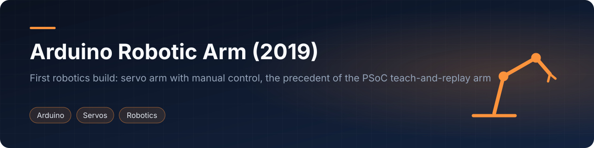</p>

<p align="center">      </p>
<p align="center"><a href="#english">English</a> · <a href="#español">Español</a></p>

## English

### Overview
My first real robotics build: an Arduino-controlled robotic arm, built in 2019 during technical high school by a team of five. It started as a wired arm with four potentiometers that could record and replay a motion, and grew into a wireless master/slave system: a sensor sleeve and glove (flex sensors and MPU-6050 IMUs) streams joint positions over Bluetooth to a second Arduino that drives the servos of a metal arm. It is the direct precedent of my later [PSoC 5LP teach-and-replay arm](https://github.com/simplementeUnPorito/psoc-embedded-projects).


<p align="center">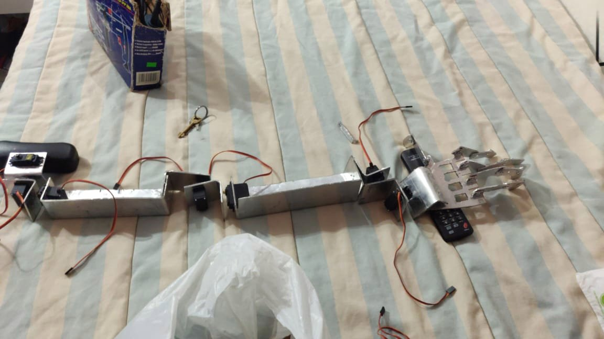<br><sub>Metal arm segments with MG995-class servos and gripper (2019 build)</sub></p>

### Highlights
- Two generations: wired (4 servos, 4 potentiometers, one button) and wireless (up to 11 servos, 6-7 analog sensors, 2 IMUs, HM-10 Bluetooth).
- Record and replay: poses are stored in a matrix; during replay the largest joint travel sets the number of micro-steps so that all servos arrive together, with ramped timing at the start and end of each move.
- IMU angles from accelerometer and gyroscope combined with a complementary filter (0.98 / 0.02), chosen in the report over a Kalman filter because of the Arduino's processing limits.
- The slave validates the Bluetooth string (incomplete or out-of-range values are discarded) before moving the servos.
- The final wired sketch removes almost every `delay()` to fix sluggish behaviour of the first version and needs an Arduino Mega.
- Per the report, the arm replicated the operator's movements over the wireless link; motion calibration was still pending.

### How it worked
- **Controller:** an Arduino on each side (sensor master and arm slave); the Mega for the larger versions.
- **Actuators:** hobby servos driven with the `Servo` library (`writeMicroseconds`, 50 Hz pulse train); MG995 for the main joints.
- **Input:** version 1 used potentiometers as joint knobs; later versions used flex sensors and MPU-6050 IMUs worn on the operator's arm and hand.
- **Modes:** a button toggles between manual (arm follows the sensors, updated every 25 ms) and automatic (replay of the recorded matrix); a switch pauses.
- **Power:** a 5 V / 10 A switching supply for the servos.

### System architecture
Control flow as drawn in the report (original diagrams in `docs/figures/`).

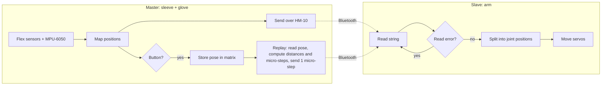

<p align="center">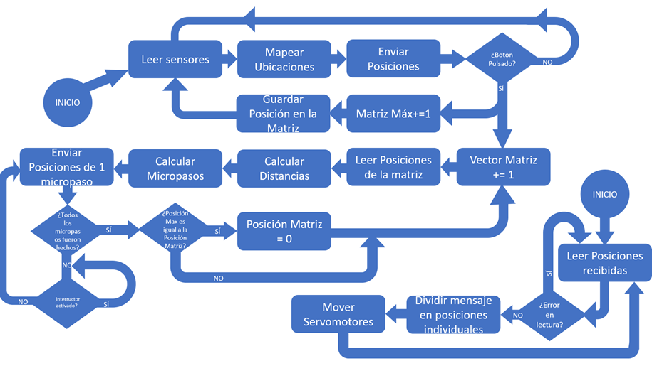<br><sub>Report flowchart: wireless master and slave programs.</sub></p>
<p align="center">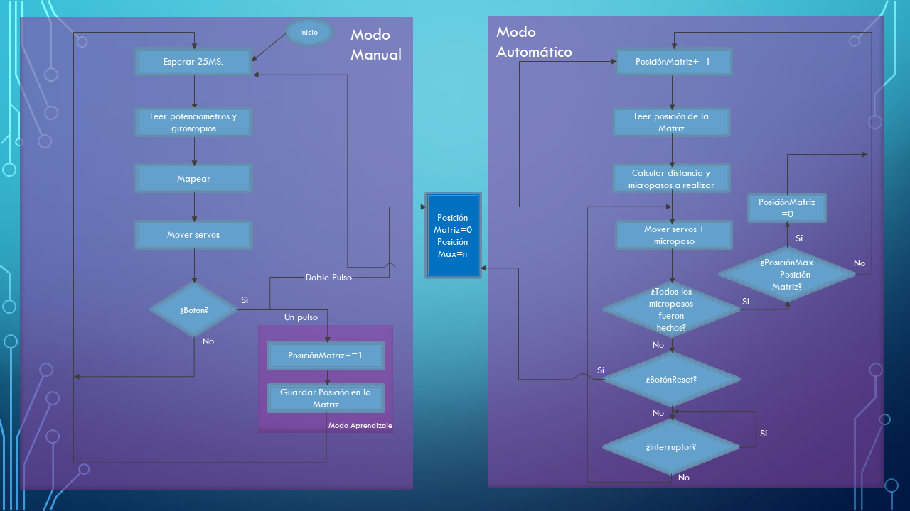<br><sub>Report flowchart: manual (learning) and automatic (replay) modes.</sub></p>

### Hardware
| Component | Role |
|-----------|------|
| Arduino Mega x2 | Master and slave controllers |
| HM-10 Bluetooth x2 | Wireless link |
| MPU-6050 IMU | Arm orientation |
| Flex sensors / potentiometers | Joint input |
| MG995 and smaller servos | Arm joints |
| 5 V / 10 A supply | Servo power |

Full list in [`hardware/`](hardware/README.md).

### Photos
<p align="center"> 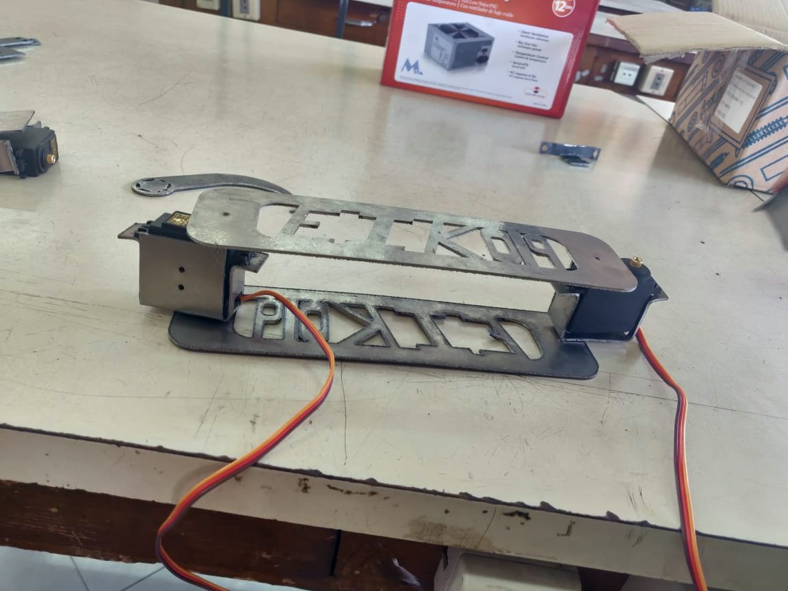</p>
<p align="center">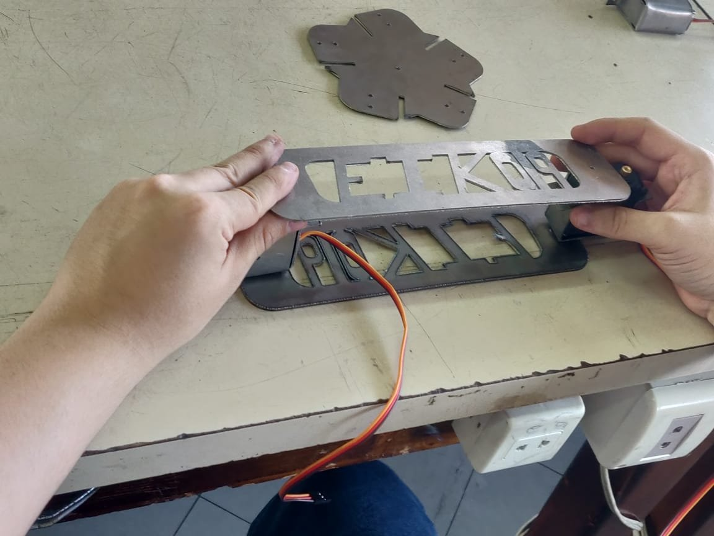 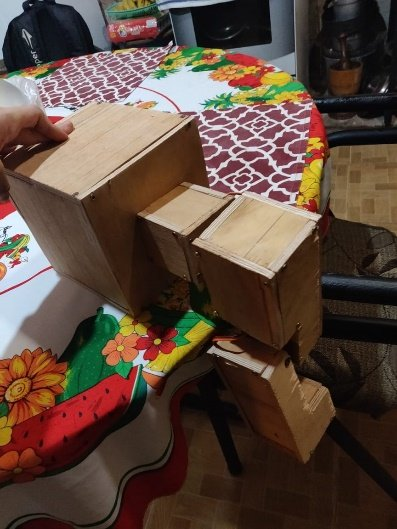 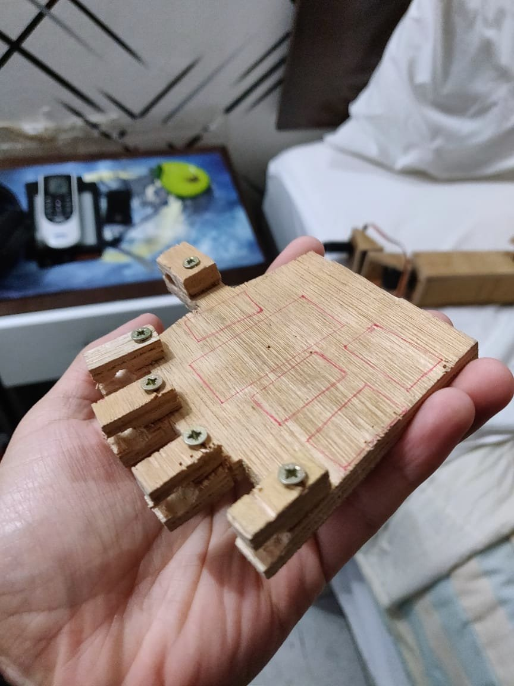</p>

<p align="center">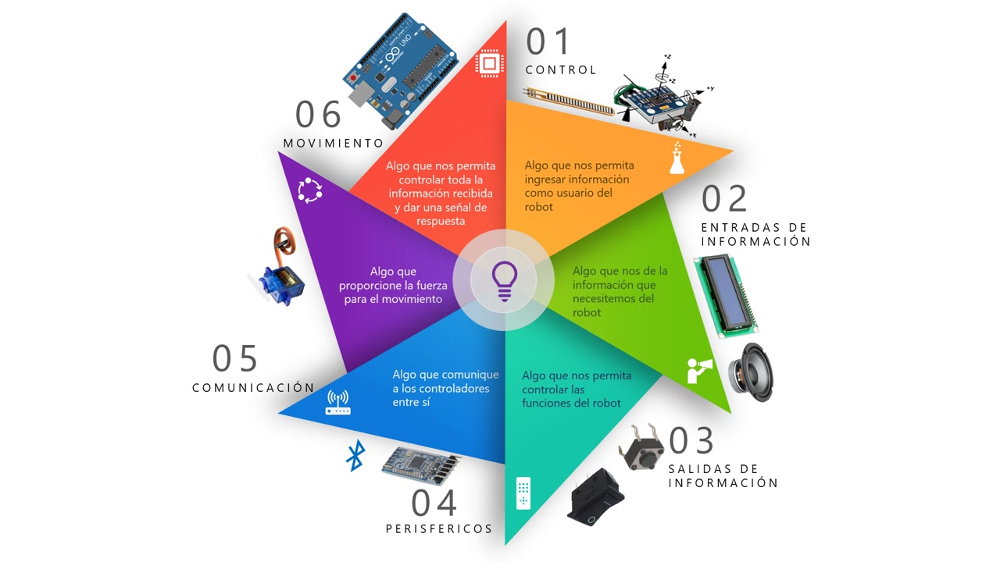<br><sub>Presentation slide: control, information inputs and outputs, peripherals, communication, movement.</sub></p>

### Repository layout
```
firmware/      4 Arduino sketches (wired record/replay, wired IMU, wireless master and slave)
hardware/      component list and construction notes
docs/img/      photos, video stills, GIF, banner
docs/figures/  flowcharts from the report
docs/video/    demo.mp4 (720p re-encode of the 2019 presentation, 1:21)
```

### Getting started
1. Arduino IDE 1.8 or later; install `AltSoftSerial` and `ServoTimer2` (`Servo` and `Wire` are bundled).
2. Open a sketch from `firmware/`. The IMU sketches target an Arduino Mega; AltSoftSerial fixes the Bluetooth pins (the transmitter comments mention 46 RX / 48 TX on a Mega).
3. Configure the HM-10 modules with AT commands (`AT+ROLE`, `AT+CON`, ...), as described in the report, before using the wireless pair.

### What came next
The record-and-replay idea (store poses, replay them smoothly) was rebuilt on a PSoC 5LP with potentiometer knobs, keypad, LCD and EEPROM storage: [psoc-embedded-projects](https://github.com/simplementeUnPorito/psoc-embedded-projects).

### Team & credits
Developed in 2019 by Elías Álvarez, Óscar Araujo, Sara Ramírez, Iván Cristaldo and Adolfo Villalba. Built in 2019 during technical high school.

### License
MIT, see [LICENSE](LICENSE). Report figures and photos are shared for reference.

## Español

### Resumen
Mi primer proyecto real de robótica: un brazo robótico controlado con Arduino, construido en 2019 durante el bachillerato técnico por un equipo de cinco personas. Comenzó como un brazo cableado con cuatro potenciómetros capaz de grabar y repetir un movimiento, y evolucionó a un sistema inalámbrico maestro/esclavo: una manga y un guante con sensores (sensores flexibles e IMU MPU-6050) envían las posiciones por Bluetooth a un segundo Arduino que mueve los servos de un brazo metálico. Es el antecedente directo de mi [brazo PSoC 5LP de enseñar y repetir](https://github.com/simplementeUnPorito/psoc-embedded-projects).

<p align="center"><br><sub>Segmentos metálicos del brazo con servos de clase MG995 y pinza (construcción de 2019)</sub></p>


### Puntos destacados
- Dos generaciones: cableada (4 servos, 4 potenciómetros, un botón) e inalámbrica (hasta 11 servos, 6-7 sensores analógicos, 2 IMU, Bluetooth HM-10).
- Grabar y repetir: las poses se guardan en una matriz; en la repetición el mayor recorrido define la cantidad de micropasos para que todos los servos lleguen a la vez, con tiempos escalonados al inicio y al final.
- Ángulos de las IMU con filtro complementario (0,98 / 0,02), elegido en el informe frente al filtro de Kalman por la capacidad de procesamiento del Arduino.
- El esclavo valida la cadena Bluetooth (descarta datos incompletos o fuera de rango) antes de mover los servos.
- El sketch cableado final elimina casi todos los `delay()` y requiere un Arduino Mega.
- Según el informe, el brazo replicó los movimientos del operador por el enlace inalámbrico; faltaba calibrar los movimientos.

### Cómo funcionaba
- **Controlador:** un Arduino a cada lado (maestro con sensores y esclavo en el brazo); Mega en las versiones mayores.
- **Actuadores:** servos controlados con la librería `Servo` (`writeMicroseconds`, 50 Hz); MG995 en las articulaciones principales.
- **Entradas:** la versión 1 usaba potenciómetros; las siguientes, sensores flexibles e IMU MPU-6050 sobre el brazo y la mano del operador.
- **Modos:** un botón alterna entre manual (el brazo sigue los sensores, cada 25 ms) y automático (repetición de la matriz grabada); un interruptor pausa.
- **Alimentación:** fuente conmutada de 5 V / 10 A para los servos.

### Arquitectura
Flujo de control tal como se representó en el informe (diagramas originales en `docs/figures/`).

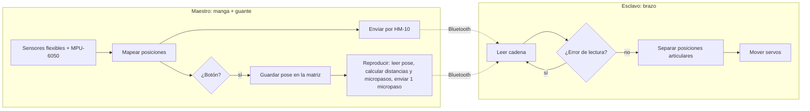

<p align="center"><br><sub>Diagrama de flujo del informe: programas maestro y esclavo inalámbricos.</sub></p>
<p align="center"><br><sub>Diagrama de flujo del informe: modos manual (aprendizaje) y automático (repetición).</sub></p>

### Hardware
| Componente | Función |
|-----------|------|
| Arduino Mega x2 | Controladores maestro y esclavo |
| HM-10 Bluetooth x2 | Enlace inalámbrico |
| IMU MPU-6050 | Orientación del brazo |
| Sensores flexibles / potenciómetros | Entrada de las articulaciones |
| Servos MG995 y menores | Articulaciones del brazo |
| Fuente de 5 V / 10 A | Alimentación de los servos |

Lista completa en [`hardware/`](hardware/README.md).

### Fotos
<p align="center"> </p>
<p align="center">  </p>

<p align="center"><br><sub>Diapositiva de la presentación: control, entradas y salidas de información, periféricos, comunicación, movimiento.</sub></p>

### Estructura del repositorio
```
firmware/      4 sketches Arduino (grabación/repetición cableada, IMU cableada, maestro y esclavo inalámbricos)
hardware/      lista de componentes y notas de construcción
docs/img/      fotos, fotogramas del video, GIF, banner
docs/figures/  diagramas de flujo del informe
docs/video/    demo.mp4 (recodificación a 720p de la presentación de 2019, 1:21)
```

### Cómo empezar
1. Usar Arduino IDE 1.8 o posterior; instalar `AltSoftSerial` y `ServoTimer2` (`Servo` y `Wire` vienen incluidas).
2. Abrir un sketch de `firmware/`. Los sketches con IMU están destinados a un Arduino Mega; AltSoftSerial fija los pines Bluetooth (los comentarios del transmisor mencionan 46 RX / 48 TX en un Mega).
3. Configurar los módulos HM-10 con comandos AT (`AT+ROLE`, `AT+CON`, ...), como se describe en el informe, antes de usar el par inalámbrico.

### Qué vino después
La idea de grabar y repetir (almacenar poses y reproducirlas con suavidad) se reconstruyó sobre un PSoC 5LP con perillas de potenciómetros, teclado, LCD y almacenamiento EEPROM: [psoc-embedded-projects](https://github.com/simplementeUnPorito/psoc-embedded-projects).

### Equipo y créditos
Desarrollado en 2019 por Elías Álvarez, Óscar Araujo, Sara Ramírez, Iván Cristaldo y Adolfo Villalba. Construido en 2019 durante el bachillerato técnico.

### Licencia
MIT, ver [LICENSE](LICENSE). Las figuras y fotos del informe se comparten como referencia.
